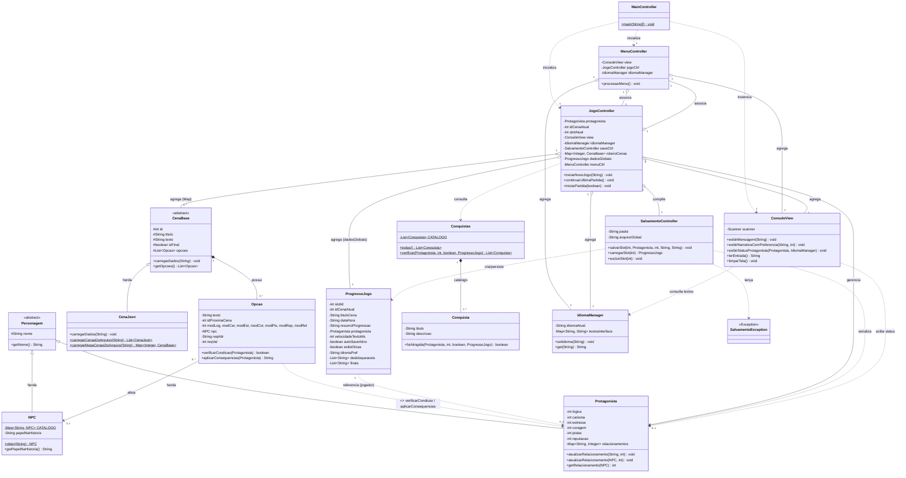

# 🌌 O Roubo Quântico — Jogo de Ficção Interativa em Java


Projeto desenvolvido como solução do Problema de Aprendizagem Baseada em Problemas (**PBL 1**) da disciplina **EXA863 - MI - Programação** do curso de Engenharia de Computação da **Universidade Estadual de Feira de Santana (UEFS)**.

---

## 📋 Sobre o Jogo

**O Roubo Quântico** é um jogo textual de ficção interativa e mistério sci-fi que se passa em um ambiente acadêmico-científico. O jogador assume o papel de um estudante investigador que precisa ajudar sua colega, Elisa, a recuperar o código de uma patente de computação quântica roubada na véspera da apresentação do TCC.

O roteiro possui **24 cenas e 4 finais distintos**. Cada escolha afeta os atributos do protagonista (**Lógica, Carisma, Estresse, Coragem, Pistas e Reputação**) e seus relacionamentos com NPCs, e alguns caminhos só ficam disponíveis se o jogador cumprir requisitos de atributos.

### Recursos do jogo
* **Atributos e relacionamentos:** cada opção pode alterar atributos e a afinidade com NPCs (Beto, Luiza, Prof. Silva), modelados pela classe `NPC` (com papel narrativo: Rival, Hacker, Orientador...). O status do protagonista é exibido no topo de cada cena.
* **Escolhas condicionadas:** opções com requisitos (`Pistas`, `CoragemAlta`, `EstresseBaixo`, `ReputacaoAlta`, `ReputacaoBaixa`, `FlagranteFalha`) aparecem marcadas como *(bloqueada)* quando o jogador não os cumpre.
* **Criar, continuar e carregar:** o menu permite **Nova Partida**, **Continuar** (retoma direto o save mais recente) e **Carregar/Excluir** (escolha manual do slot).
* **3 slots de salvamento:** salvar, carregar, sobrescrever (com confirmação) e excluir partidas. Cada save exibe **nome do jogador, capítulo (título da cena), data/hora e um resumo da progressão**, e guarda atributos, reputação e relacionamentos.
* **Autosave:** ao chegar na cena do marco narrativo, salva automaticamente no slot da partida atual ou no primeiro slot vazio. Nunca sobrescreve o save de outro slot.
* **19 conquistas:** marcos da história, atributos altos (Lógica, Carisma, Coragem, Pistas, Estresse), relacionamentos (Prof. Silva, Luiza, Beto), cada um dos 4 finais, desafios dentro dos finais (ex.: terminar com Estresse zerado) e duas meta-conquistas (descobrir os 4 finais e desbloquear todas as outras). O jogador é avisado na hora em que desbloqueia.
* **Galeria e finais:** mostra o progresso das conquistas (ex.: `4/19`), com as obtidas descritas e as pendentes ocultas (`???`), além dos finais alcançados. Tudo persiste entre partidas.
* **Preferências e Multi-idioma:** velocidade do texto (lenta ou instantânea), autosave, dicas de jogo ligados/desligados e **seleção de idioma** (**Português `pt_BR`**, **Inglês `en_US`** e **Espanhol `es_ES`**), traduzindo menus e roteiro em tempo real.
* **Interface limpa:** o terminal é apagado a cada troca de cena ou menu, exibindo somente a tela atual, sem histórico. Detalhes internos como o número da cena não são mostrados ao jogador.

---

## 🏛️ Arquitetura e Padrões de Projeto

O projeto foi construído em **Java puro (sem frameworks ou bibliotecas externas de terceiros)**, respeitando o padrão **MVC (Model-View-Controller)** e organizado em pacotes modulares:

```text
                    ┌────────────────────────────┐
                    │ controllers.MainController │
                    └─────────────┬──────────────┘
                                  │ (Inicializa)
        ┌─────────────────────────┴───────────────────────────┐
        ▼                                                     ▼
┌────────────────────┐          ┌──────────────────────────────────────────────┐
│ views.ConsoleView  │ ◄──────► │ controllers.JogoController                   │
│ (Camada View)      │ Interage │ controllers.MenuController                   │
└────────────────────┘          │ controllers.SalvamentoController             │
                                │ (Camada Controller)                          │
                                └──────────────────────┬───────────────────────┘
                                                       │ Manipula
                                                       ▼
                                  ┌──────────────────────────────────────────┐
                                  │ models.*                                 │
                                  │ (Protagonista, CenaJson, Opcao,          │
                                  │  NPC, Conquistas, IdiomaManager, etc)    │
                                  └──────────────────────────────────────────┘
```

A camada `models` não depende de `views` nem de `controllers` (e não realiza nenhuma impressão direta no console), enquanto a camada `views` apenas imprime e lê entradas: toda regra de jogo (requisitos, consequências, salvamento) fica em `models` e `controllers`.

### Diagrama de Classes UML (com Cardinalidades, Herança, Dependência e Agregação)



### Principais Decisões de Engenharia
* **Organização em Pacotes:** separação clara entre as camadas `models`, `views` e `controllers`.
* **Parser de JSON Nativo:** leitura dos arquivos de roteiro (`Roteiro_*.json`), de interface (`Interface_*.json`) e dos arquivos de save com Expressões Regulares (`java.util.regex`) e varredura de chaves respeitando strings e escapes, sem Gson ou Jackson. Os arquivos são lidos e gravados em **UTF-8**.
* **Encapsulamento com Trava Numérica:** nenhum atributo do personagem assume valores negativos (`Math.max(0, valor)`).
* **Polimorfismo e Extensibilidade:** classe abstrata `CenaBase` estendida por `CenaJson`, permitindo incluir novas fontes de dados ou tipos de cena.
* **Mapeamento de Relacionamentos:** `HashMap<String, Integer>` para gestão de afinidades com NPCs.
* **Tratamento de erros de persistência:** falhas de leitura/gravação e slots inválidos lançam `SalvamentoException`, tratada pelos controllers.
* **Entrada encerrada:** se a entrada padrão terminar (ex.: Ctrl+Z / Ctrl+D), o jogo encerra de forma limpa.

---

## 📦 Estrutura de Pastas do Repositório

```text
.
├── src/
│   ├── controllers/
│   │   ├── MainController.java         # Ponto de entrada do programa
│   │   ├── MenuController.java         # Menu principal e navegação inicial
│   │   ├── JogoController.java         # Loop narrativo, escolhas, saves, preferências e galeria
│   │   └── SalvamentoController.java   # Leitura/gravação de slots e dados globais
│   ├── models/
│   │   ├── Personagem.java             # Classe abstrata base para entidades
│   │   ├── Protagonista.java           # Jogador: atributos, reputação e relacionamentos
│   │   ├── NPC.java                    # Personagens secundários (catálogo único por nome, com papel narrativo)
│   │   ├── CenaBase.java               # Estrutura base abstrata de cena
│   │   ├── CenaJson.java               # Parser e construtor de cenas via JSON (Regex)
│   │   ├── Opcao.java                  # Requisitos e consequências de cada escolha
│   │   ├── Conquista.java              # Uma conquista (título, descrição e regra de desbloqueio)
│   │   ├── Conquistas.java             # Catálogo das 19 conquistas e verificação de desbloqueio
│   │   ├── IdiomaManager.java          # Internacionalização (i18n) dos textos de interface (pt_BR, en_US, es_ES)
│   │   ├── ProgressoJogo.java          # Estado de um slot e dados globais (preferências, idioma, galeria, finais)
│   │   └── SalvamentoException.java    # Exceção de persistência
│   ├── views/
│   │   └── ConsoleView.java            # Entrada/saída e limpeza do terminal
│   ├── tests/                          # Testes de unidade (Java puro, sem JUnit)
│   │   ├── Teste.java                  # Base com as verificações (verificar, verificarIgual, verificarLanca)
│   │   ├── ProtagonistaTest.java       # Protagonista e NPC
│   │   ├── OpcaoTest.java              # Requisitos e consequências
│   │   ├── CenaJsonTest.java           # Parser, IdiomaManager e integridade dos roteiros (4 finais)
│   │   ├── ConquistasTest.java         # Catálogo, desbloqueio, meta-conquistas e alcance de todas no roteiro
│   │   ├── SalvamentoControllerTest.java # Slots, dados globais, idioma e exceção (em pasta temporária)
│   │   └── TestRunner.java             # Executa todos os testes
│   └── jsonFiles/
│       ├── Roteiro_pt_BR.json          # Roteiro em Português (Brasil)
│       ├── Roteiro_en_US.json          # Roteiro em Inglês
│       ├── Roteiro_es_ES.json          # Roteiro em Espanhol
│       ├── Roteiro.json                # Roteiro base (fallback)
│       ├── Interface_pt_BR.json        # Textos de interface em Português
│       ├── Interface_en_US.json        # Textos de interface em Inglês
│       ├── Interface_es_ES.json        # Textos de interface em Espanhol
│       ├── save_slot_1..3.json         # Saves (gerados pelo jogo)
│       └── dados_globais.json          # Preferências, idioma, galeria e finais (gerado pelo jogo)
└── README.md                           # Documentação do repositório
```

---

## 🎮 Como Jogar

* **Menu principal:** Nova Partida, Continuar (último save), Carregar/Excluir Saves, Galeria de Conquistas e Finais, Preferências (velocidade, autosave, dicas e idioma), Instruções e Créditos, Sair.
* **Durante a história:** digite o número da escolha desejada e pressione ENTER.
  * `7` — Preferências
  * `8` — Salvar (escolha um dos 3 slots)
  * `9` — Voltar ao Menu Principal

---

## 🛠️ Como Compilar e Executar

### Pré-requisitos
* **Java Development Kit (JDK) 17** ou superior instalado e configurado nas variáveis de ambiente.

### Passo a Passo pelo Terminal

1. **Clonar o repositório:**
   ```bash
   git clone https://github.com/Serpentyle02/PBL-Java.git
   cd PBL-Java
   ```

2. **Compilar todos os pacotes a partir da pasta raiz:**
   ```bash
   javac -encoding UTF-8 -d bin src/models/*.java src/views/*.java src/controllers/*.java src/tests/*.java
   ```

3. **Executar a aplicação a partir da pasta raiz:**

   * Linux / macOS:
     ```bash
     java -cp bin controllers.MainController
     ```
   * Windows:
     ```cmd
     chcp 65001
     java -cp bin controllers.MainController
     ```

> **Nota:** execute sempre a partir da **pasta raiz** do projeto. O jogo procura os arquivos de roteiro e interface em `src/jsonFiles/` e grava os saves na mesma pasta, usando caminhos relativos ao diretório de execução. No Windows, `chcp 65001` evita acentos quebrados no terminal.

---

## ✅ Testes de Unidade

Os testes são escritos em **Java puro** (sem JUnit, mantendo o projeto sem dependências externas) e ficam em `src/tests/`. Execute-os a partir da **pasta raiz**:

```bash
java -cp bin tests.TestRunner
```

Cobertura principal:
* **Protagonista / NPC:** trava numérica dos atributos, relacionamentos e catálogo de NPCs.
* **Opcao:** todos os requisitos de acesso (`Pistas`, `CoragemAlta`, `EstresseBaixo`, `ReputacaoAlta`, `ReputacaoBaixa`, `FlagranteFalha`) e a aplicação de consequências.
* **CenaJson / IdiomaManager:** interpretação de blocos JSON, carregamento de idiomas (`pt_BR`, `en_US`, `es_ES`) e validação do roteiro real: todos os destinos existem, não há becos sem saída e **os 4 finais são alcançáveis** (busca exaustiva de combinações de escolhas e atributos).
* **Conquistas:** títulos únicos, desbloqueio sem repetição, meta-conquistas e a garantia de que **todas as conquistas são alcançáveis** no roteiro real (busca exaustiva).
* **SalvamentoController / SalvamentoException:** salvar, carregar, sobrescrever, excluir, slots inválidos, save corrompido, dados globais (incluindo idioma) e slot mais recente (gravando em pasta temporária, sem alterar os saves do jogador).

O executor termina com código de saída diferente de zero se algum teste falhar.

---

## 👨‍💻 Autores

* **Renan Queiroz dos Santos** - *Engenharia de Computação - UEFS*
* **Felipe Pereira** - *Engenharia de Computação - UEFS*
